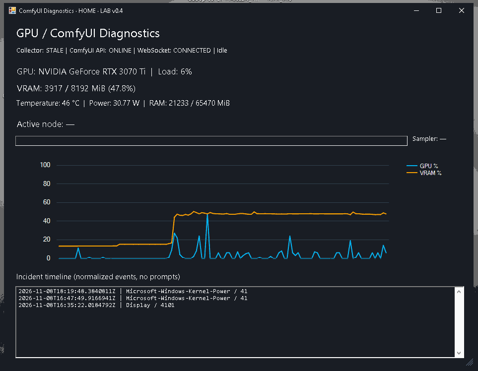

# ComfyUI Diagnostics Monitor

**Windows 10/11 · NVIDIA GPU · ComfyUI / 3ds Max · Local-first diagnostics**

> **v0.9.0 UNIFIED UI LAB CANDIDATE — NOT PRODUCTION.** Windows CI validates package creation, installation and automated regressions. Real GPU hardware, high-DPI layout, long-running Collector and system freeze capture require continued HOME/WORK acceptance. This utility does not diagnose hardware failures with certainty. v0.9 Windows CI is pending; do not treat the unified UI as production-ready until accepted on HOME/WORK.

## Dashboard preview



*Authentic HOME RTX 3070 Ti screenshot from the earlier LAB v0.4 UI (November 8, 2026). This is historical test evidence, **not** a screenshot of the current v0.8.0 interface. Current v0.9 unifies the user-facing interface into four RU/EN tabs; an authentic v0.9 screenshot requires real Windows acceptance.*


Read-only monitoring for creative Windows workstations: inspect GPU / VRAM, CPU / RAM, 3ds Max process memory, Windows reliability events and local ComfyUI execution, without modifying your 3D projects, AI models or drivers.

## Features

| Feature | Details |
| --- | --- |
| **Монитор / Monitor** | One desktop window with automatically managed in-process Collector, GPU/VRAM/CPU/RAM cards, telemetry chart, 3ds Max memory and status |
| **Генерации / Generations** | ComfyUI WebSocket active node ID, sampler steps, normalized run events without auto-saving private prompts or images |
| **Compact HUD** | Always-on-top GPU/VRAM overlay; F9, double-click restore, drag to reposition |
| **Настройки / Settings** | RU by default; EN selectable, local preference saved to diagnostic folder; manual update checker |
| **Диагностика / Diagnostics** | Integrated Evidence tab: user-triggered local JSON snapshots from Windows Events, Reliability Records, processes, storage and ComfyUI localhost API/logs |
| **Open Logs Folder** | One click from Dashboard or Configurator opens `%LOCALAPPDATA%\ComfyUI-Diagnostics` |
| **HOME / WORK** | Explicit per-machine profile; no hardcoded user directory |
| **Updates** | Background **version check** at Dashboard startup and manual Check updates button. Installer updates are **user-confirmed**; no silent replacement of unsigned executables |
| **Privacy** | No remote telemetry upload, prompt content, model changes, Windows TDR edits or background services |

### Download and install

Get the **unsigned LAB executable** from the [latest GitHub release](https://github.com/lutiy-dev/ComfyUI-Diagnostics-Monitor/releases) or from the exact-head [Windows CI artifact](https://github.com/lutiy-dev/ComfyUI-Diagnostics-Monitor/actions/workflows/windows-installer.yml). The build includes:

- `ComfyUI-Diagnostics-Setup-v0.9-LAB.exe` — a non-admin GUI setup for HOME or WORK, with in-place upgrade and local-data preservation.
- `ComfyUI-Diagnostics-LAB-v0.9.zip` — inspectable portable package. Extract its **inner** `ComfyUI-Diagnostics-LAB` folder and double-click `Install-or-Update.bat` as an alternative to the GUI EXE.
- `*.sha256` and `package-manifest.json` — package integrity records, **not** a code-signing certificate.

**Important:** The EXE is **not digitally signed**. Windows Defender/SmartScreen may flag an unknown publisher; do not bypass malware warnings without inspecting the build origin and checksum. Neither install route requires administrator privileges. Close Dashboard, Collector and Configurator before upgrading. Do not run multiple Collectors.

After installation, open **Start Menu → ComfyUI Diagnostics LAB → Monitor**. A single main window shows Монитор, Генерации, Диагностика, Настройки. The monitor starts an in-process Collector automatically and releases it on exit. Do not run a legacy separate Collector at the same time; the new mutex protects only v0.9 instances.

| Folder | Purpose |
| --- | --- |
| `%LOCALAPPDATA%\Programs\ComfyUI-Diagnostics` | Installed application; version/config manifest and launch scripts |
| `%LOCALAPPDATA%\ComfyUI-Diagnostics` | Local user data: `telemetry_HOME_*.jsonl`, `events_HOME_*.jsonl`, `live_HOME_*.jsonl`, `evidence\evidence_HOME_*.json` (WORK equivalents) |

**Open Logs Folder** opens the second directory without uploading anything. Review and redact personal/client data before sharing any logs, screenshots or Evidence JSON.

### Capture evidence after a crash

1. Restart Windows only if necessary; do not force repeated GPU stress tests on an unstable machine.
2. Open **Диагностика / Diagnostics** in the Monitor and select the relevant Windows history window (for example, 24 hours).
3. Leave Windows Events enabled, keep **private RAW ComfyUI log** disabled unless specifically required, then click **Capture Evidence**.
4. Click **Открыть отчёты / Open reports** or **Открыть логи / Open logs** and inspect the new `evidence_HOME_*.json` (or WORK) before sharing it.

An Evidence JSON is created on demand, **not automatically when Windows freezes**. The in-process Collector must be running to record continuous samples. It starts with the unified Monitor, not on system boot. Events 41, 4101 or LiveKernelEvent 141 are signals to investigate, not proof of an exact root cause.

### Update policy

On startup the Dashboard checks GitHub release metadata in a background job, without blocking its UI. If a newer published version is found, **Update available** appears. Clicking it opens the official GitHub release page after confirmation. **Installation remains an explicit user action** through the EXE/BAT; no silent auto-download, forced install or restart. This is intentional until signed distribution, staged rollback and live Collector shut-down are verified.

### Limitations

- CPU load uses Windows WMI and is approximate; `3dsmax.exe` memory is an aggregated process working-set, not an independent Corona Renderer measurement.
- GPU history depends on `nvidia-smi` and running Collector; RAM/CPU may remain available when NVIDIA is offline.
- The GUI currently uses WinForms, not a fully responsive native Windows desktop application; HOME/WORK high-DPI manual screenshots are still required.
- No automatic memory/cache purge, registry changes, hardware stress tests, services, auto-start, telemetry uploads or unsigned silent updates.
- v0.9 is a **LAB candidate**, not a verified stable or PRODUCTION deployment.

### Development and documentation

See [AGENTS.md](AGENTS.md) for mandatory maintenance and security rules. Test and scope references:

- [Unified UI v0.9 LAB candidate — scope and limitations](docs/RELEASE_V09_LAB.md)
- [Windows installation, upgrade and rollback](docs/WINDOWS_INSTALL.md)
- [Evidence reliability acceptance](docs/DIAGNOSTICS_V07.md)
- [System CPU/RAM and 3ds Max telemetry](docs/CPU_RAM_3DSMAX.md)
- [Dashboard / HUD consistency](docs/UI_LAYOUT_PASS.md)
- [In-app update safety](docs/IN_APP_UPDATES.md)
- [Package security](docs/PACKAGE_SECURITY.md)
- [ChatGPT diagnostics access](docs/CHATGPT_DIAGNOSTICS_ACCESS.md)

Basic offline checks:

```powershell
python -m unittest discover -s tests -v
.\unified.ps1 -SelfTest
.\dashboard.ps1 -SelfTest
.\configurator.ps1 -SelfTest
.\evidence.ps1 -Machine HOME -DataRoot "$env:TEMP\ComfyUIDiagnosticsTest" -SkipWindows -SkipProcesses -SkipStorage -SkipComfy -SelfTest
```

**Project workflow:** inspect → capture → validate sources → correlate → test one variable → document PASS/FAIL. Never treat CI or a diagnostic warning as proof of GPU hardware failure.
